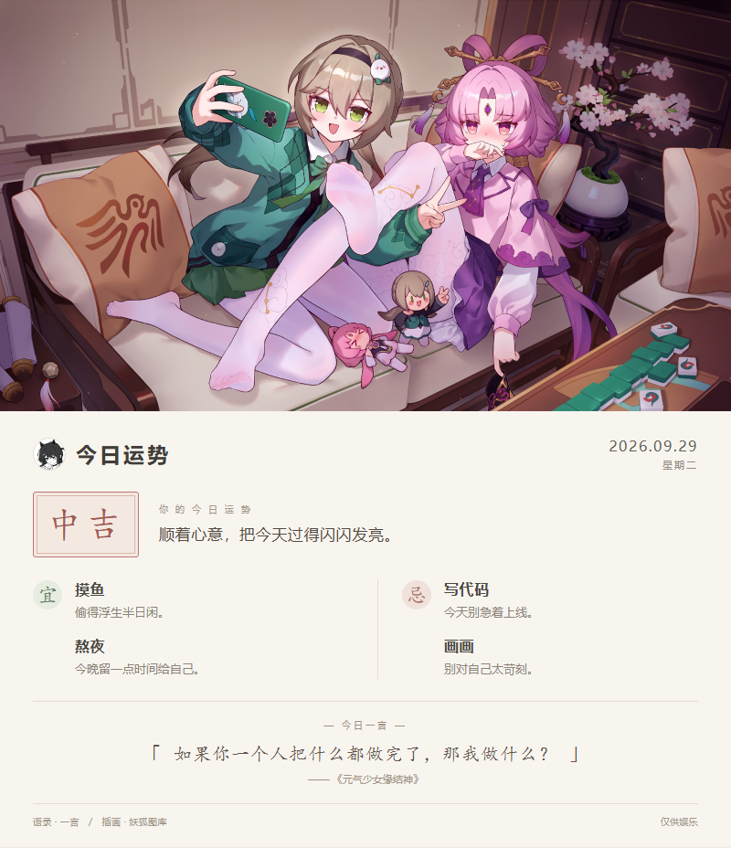

<div align="center">

# 🔮 今日运势与今日老婆

**每天抽一张运势签，再领一位二次元老婆。**

✨ [AstrBot](https://github.com/AstrBotDevs/AstrBot) · QQ 官方机器人 / OneBot · 免费图源，无需 API Key ✨

[](LICENSE)
[](https://www.python.org/)
[](https://github.com/AstrBotDevs/AstrBot)
[](https://github.com/yun474)


[功能亮点](#features) · [效果预览](#preview) · [安装使用](#usage) · [MD 模式](#markdown) · [配置项](#config) · [图床配置](#image-host) · [常见问题](#faq)

</div>

---

<a id="features"></a>

## ✨ 能玩什么

- **今日运势**：用户头像 + 二次元插画 + 吉凶、宜忌与一言，按插画比例自动排版，不显示昵称。
- **今日老婆**：抽一位角色，展示角色名、所属作品和插画。
- **每天固定**：按北京时间每日更新，同一平台实例内当天结果不变，重启后仍保留。
- **QQ MD 模式（可选）**：QQ 官方群聊、私聊可发送 Markdown 图文，附带「今日老婆」「今日运势」快捷按钮，默认使用免配置的 QQ 素材库，开启即可使用。

没有签到、经验、等级或货币系统，抽完就走，轻轻松松~

<a id="preview"></a>

## 🎴 效果预览

<table>
  <tr>
    <th>🔮 今日运势</th>
    <th>💝 今日老婆</th>
  </tr>
  <tr>
    <td valign="top"></td>
    <td valign="top"></td>
  </tr>
</table>

预览图由插件模板实际渲染，图中为演示头像。横图、方图完整展示，下方搭配暖白底与朱红签印；竖图使用整张背景加半透明信息面板。

<a id="usage"></a>

## 🚀 安装与使用

### 1. 安装插件

在 AstrBot 插件管理中选择从链接安装，填入仓库地址 `https://github.com/yun474/astrbot_plugin_daily_fortune`。需要 **AstrBot 3.5.3 或更新版本**，支持 QQ 官方 WebSocket、QQ 官方 Webhook 和 OneBot（aiocqhttp）。

### 2. 准备图片渲染环境

卡片需要 Chromium 渲染。在 **AstrBot 使用的 Python 环境**中，进入插件目录执行：

```bash
python -m pip install -r requirements.txt
python -m playwright install chromium
```

Linux / Docker 还需要浏览器运行库和中文字体（Debian / Ubuntu，需 root）：

```bash
python -m playwright install-deps chromium
apt-get update && apt-get install -y fonts-noto-cjk
```

Docker 部署请在 AstrBot 容器内安装，并写进自定义镜像，避免重建容器后丢失。已经装好 Chrome / Chromium 的话，也可以在配置里填 `browser_executable_path` 直接用现有浏览器。

### 3. 开始抽签

启用或重载插件后，在群里 @机器人发送：

| 指令 | 别名 | 用途 |
| --- | --- | --- |
| `/今日运势` | `/jrys`、`/运势` | 抽取今日运势 |
| `/今日老婆` | `/jrlp`、`/抽老婆` | 抽取今日老婆 |
| `/运势原图 [@用户]` | — | 获取运势背景原图 |
| `/老婆原图 [@用户]` | — | 获取老婆角色原图 |
| `/运势素材库 [删除缓存/删除全部]` | — | 管理员查看或清理本机器人 QQ 素材库（可在配置中关闭） |

上表以 `/` 为前缀，实际以 AstrBot 配置为准；自定义唤醒词同样可用，例如「云云今日老婆」。指令命中后不会再触发 AI 回复。

**获取原图**：先抽取运势或老婆，再发送对应原图指令，机器人只发图片，不叠加头像和信息栏。在指令后 @某位群友可以获取对方当天的原图（多个 @ 取第一个），不会替对方重新抽取；当天没有记录时不回复。

<a id="markdown"></a>

## 📱 QQ MD 模式

两项功能默认发送合成图。在 QQ 官方群聊和私聊中，可分别开启 `qq_fortune_markdown`（今日运势）和 `qq_wife_markdown`（今日老婆），消息开头 @发送者，结尾附两个快捷按钮：

<table>
  <tr>
    <th>今日老婆 MD</th>
    <th>今日运势 MD</th>
  </tr>
  <tr>
    <td valign="top">

> @用户
>
> 您的今日老婆是：**芙宁娜**
>
> 作品：原神
>
> （角色图片）
>
> 要好好对她哦~
>
> 【今日老婆】　【今日运势】

</td>
    <td valign="top">

> @用户
>
> 今日运势
>
> （完整运势卡）
>
> 请勿迷信，仅供参考
>
> 【今日老婆】　【今日运势】

</td>
  </tr>
</table>

以上为内容示意，图片与按钮的实际外观由 QQ 客户端呈现。完整请求体示例：[老婆 MD](docs/wife-qq-payload.json) · [运势 MD](docs/fortune-qq-payload.json)。

- **按钮唤醒词**：如果 AstrBot 设置了 `/` 等唤醒词，在 `qq_command_prefix` 中填写相同内容，按钮会发送 `@机器人 /今日运势`。内容原样拼接，留空保持默认。
- **图片压缩**：上传前统一转为最长边 1600 像素、不超过 1 MiB 的 JPEG；使用自建图床时，当天相同图片复用已上传地址；使用 QQ 素材库时，图片发送后即删除，可按需开启缓存。需要未压缩的图片请用原图指令。
- **失败兜底**：MD 在发送前失败，或 QQ 明确返回错误时，自动改发普通合成图；QQ 请求超时、结果不明时只回复提示，避免重复消息。
- OneBot 和 QQ 频道场景始终发送合成图。

<a id="config"></a>

## ⚙️ 配置项说明

在 AstrBot 插件管理中打开配置页修改并保存，重载插件后生效。调整缓存和并发不会重抽当天结果。

| 配置项 | 默认值 | 说明 |
| --- | --- | --- |
| `background_url` | 妖狐二次元图库 | 运势卡背景，填图片直链或本地路径 |
| `background_credit` | 妖狐图库 | 卡片上的背景来源标注 |
| `hitokoto_api` | 一言动画、漫画分类 | 一言接口；留空使用内置句子 |
| `browser_executable_path` | 留空 | Chrome / Chromium 路径；留空使用 Playwright Chromium |
| `wife_list_url` | `https://animewife.dpdns.org/list.txt` | 今日老婆角色列表 |
| `wife_image_base` | `https://raw.githubusercontent.com/monbed/wife/main/` | 角色图片的公网基础地址 |
| `qq_wife_markdown` / `qq_fortune_markdown` | 关闭 | 今日老婆 / 今日运势 MD 模式，默认使用 QQ 素材库 |
| `qq_command_prefix` | 留空 | MD 按钮的自定义唤醒词，如 `/` |
| `show_image_host` | 收起 | 展开／收起图床配置，只影响显示 |
| `cache_retention_days` | `7` | 缓存保留天数（含今天），1～365 |
| `cache_cleanup_interval_hours` | `6` | 自动清理间隔，1～168 小时 |
| `wife_catalog_cache_hours` | `24` | 角色列表缓存时间，1～168 小时 |
| `request_timeout_seconds` | `15` | 图片、角色列表和一言的下载超时，5～120 秒 |
| `render_concurrency` | `2` | 运势卡与老婆合成图共用的生成并发数，1～4 |

<a id="image-host"></a>

## 🖼️ 图床配置

只有开启 MD 模式时才需要图床。打开「展开图床配置」，在「图床类型」中选择服务商，页面只显示对应参数；各类型独立保存，切换回来无需重填。配置完成后可以收起，不影响上传。新安装默认使用免配置的「QQ 素材库」；从旧版本升级时，已保存的图床选择保持不变，如需改用 QQ 素材库，在此切换即可。

### QQ 素材库（默认，免配置）

「QQ 素材库」使用 QQ 官方机器人自带的 [素材管理接口](https://bot.q.qq.com/wiki/develop/api-v2/server-inter/message/material-management.html)，无需自建图床，也无需填写任何参数：插件直接沿用 AstrBot 中已配置的 QQ 官方机器人凭据，接入多个机器人时按各自账号分别处理。每张图片随消息上传，消息发送结束后立即尝试删除；平台已为发出的消息保存图片副本，删除不影响已发送的图片。删除失败时会在后台重试，不拖慢回复。

- **100 张限制**：QQ 官方规定每个机器人最多保存 100 张有效素材，同一机器人上的其他插件共用这一额度。本插件每条消息结束即删除，同一时间通常只临时占用几张；如因中断留下残图，插件首次上传及运行期间的定期扫描会自动清理 10 分钟前上传、文件名以 `fortune-` 开头的图片，不会删除其他插件的素材。
- **图片缓存**：「QQ 素材库配置」中的「图片缓存时间」可设为 0～1440 分钟，默认 0 为即用即删。设置后，同一张运势卡或老婆图在缓存期内复用同一张素材，到期自动删除，可减少重复上传。每张缓存图片占用一格共用额度，额度已满时插件会先释放自己的缓存再重试；插件停用或重载时也会尽量删除缓存。
- **频率限制**：官方文档目前没有说明素材接口的调用频率限制。每张图片需要额外调用申请上传、完成上传和删除三个接口；开启图片缓存可减少这部分调用。
- **自动降级**：遇到频率限制、素材库已满或机器人没有接口权限时，插件会自动改发普通合成图，保证消息照常送达，并在日志中记录原因。
- **查看与清理**：管理员发送 `运势素材库`，可查看本机器人素材库的总占用、本插件（含缓存图片）和其他插件各占几张，以及待清理的残留。发送 `运势素材库 删除缓存` 删除本插件的全部素材；发送 `运势素材库 删除全部` 清空整个素材库，**其他插件上传的素材也会被删除**，请谨慎使用。两种清理都会跳过正在发送的图片。查询与清理每次最多等待 30 秒（包括分页、等待清理锁和逐张删除），清理未完成时会报告剩余数量，可再次发送指令继续；只查询占用或手动清理不会启用后台自动扫描。该指令可在「图床配置 → QQ 素材库配置」中关闭；关闭后插件不响应该指令，切换到其他图床后仍按已保存的开关处理。

素材接口刚上线不久，如果你遇到限流、额度或图片显示等问题，欢迎到 [Issues](https://github.com/yun474/astrbot_plugin_daily_fortune/issues) 提交反馈，最好附上相关日志。

### 自建图床

图片公网地址必须能被 QQ 服务器直接访问。插件不会修改桶权限、ACL 或域名，请提前配置好公开读取；仅支持长期访问密钥，不支持 STS 临时凭据。

**兰空 Lsky Pro V2 / 自定义 HTTP**：

| 配置项 | 默认值 | 填写内容 |
| --- | --- | --- |
| `upload_url` | 留空 | 完整 POST 上传地址，如 `https://你的图床/api/v1/upload` |
| `authorization` | 留空 | Authorization 请求头，如 `Bearer 你的Token`；匿名接口可留空 |
| `file_field` | `file` | multipart 文件字段名（兰空自动设置） |
| `url_path` | `data.links.url` | 响应 JSON 中图片直链的路径，支持 `data.0.url` 等数组路径（兰空自动设置） |

自定义 HTTP 兼容 `multipart/form-data` 上传并返回 JSON 的图床，不支持网页表单登录。默认格式参考 [兰空 V2 上传配置](https://github.com/lsky-org/lsky-pro/discussions/357)。

**Cloudflare R2**（字段位于 `image_host.r2`）：

| 配置项 | 填写内容 |
| --- | --- |
| `endpoint` | `https://<ACCOUNT_ID>.r2.cloudflarestorage.com`，复制 R2 控制台的 S3 API 端点 |
| `bucket` | 桶名称，如 `bot-images` |
| `access_key_id` / `secret_access_key` | R2 S3 API 凭据，需有该桶的写入权限；不是 Cloudflare API Token |
| `region` | 留空，自动使用 `auto` |
| `public_base_url` | 桶绑定的公开域名，如 `https://img.example.com`；测试可用 `https://pub-xxx.r2.dev` |
| `key_prefix` | 默认 `daily-fortune`，可留空 |
| `addressing_style` | 保持 `auto` |

`endpoint` 用于上传签名，`public_base_url` 用于图片访问，两者不要填反。最终图片地址形如 `https://img.example.com/daily-fortune/2026-09-29/<图片哈希>.jpg`。参考 [R2 S3 接入文档](https://developers.cloudflare.com/r2/examples/aws/boto3/) 与 [公开访问配置](https://developers.cloudflare.com/r2/buckets/public-buckets/)。

<details>
<summary>R2 配置片段示例</summary>

```json
{
  "qq_wife_markdown": true,
  "qq_fortune_markdown": true,
  "show_image_host": true,
  "image_host": {
    "provider": "Cloudflare R2",
    "r2": {
      "endpoint": "https://ACCOUNT_ID.r2.cloudflarestorage.com",
      "bucket": "bot-images",
      "access_key_id": "YOUR_ACCESS_KEY_ID",
      "secret_access_key": "YOUR_SECRET_ACCESS_KEY",
      "region": "",
      "public_base_url": "https://img.example.com",
      "key_prefix": "daily-fortune",
      "addressing_style": "auto"
    },
    "retry_count": 3,
    "timeout_seconds": 30
  }
}
```

</details>

<details>
<summary>其他对象存储（AWS S3、阿里云 OSS、腾讯云 COS 等）</summary>

字段与 R2 相同，密钥填对应厂家的访问密钥。端点需包含 `https://` 且不含桶名（本地 MinIO 可用 `http://主机:端口`）；`public_base_url` 填桶的公开访问地址或 CDN 地址，路径式访问时包含桶名。

| 图床类型 | 上传端点示例 | 区域与寻址 |
| --- | --- | --- |
| AWS S3 | `https://s3.ap-southeast-1.amazonaws.com` | 填实际区域；virtual |
| 阿里云 OSS | `https://s3.oss-cn-hangzhou.aliyuncs.com` | 区域可留空；S3 V2 签名，强制 virtual |
| 腾讯云 COS | `https://cos.ap-guangzhou.myqcloud.com` | `ap-guangzhou`；virtual；桶名含 `-APPID` |
| 七牛云 Kodo | `https://s3.cn-east-2.qiniucs.com` | `cn-east-2`；virtual |
| MinIO | `https://s3.example.com` | 默认 `us-east-1`；path；填 S3 API 端口而非管理面板 |
| Backblaze B2 | `https://s3.us-west-004.backblazeb2.com` | 以控制台为准；path；密钥为 keyID / applicationKey |
| DigitalOcean Spaces | `https://nyc3.digitaloceanspaces.com` | 以桶区域为准；virtual |
| 其他 S3 兼容存储 | 厂家提供的 S3 API 端点 | 默认 `us-east-1`；path；可手动修改 |

适配依据：[OSS](https://help.aliyun.com/zh/oss/developer-reference/use-aws-sdks-to-access-oss) · [COS](https://intl.cloud.tencent.com/document/product/436/34688?lang=en) · [七牛](https://developer.qiniu.com/kodo/4088/s3-access-domainname) · [B2](https://www.backblaze.com/docs/en/cloud-storage-call-the-s3-compatible-api) · [Spaces](https://docs.digitalocean.com/reference/api/spaces/)。已用本地 HTTP 服务验证上传与签名，未使用各厂家真实账户逐一联调。

</details>

**重试与超时**：`retry_count` 默认 `3`（0～10，不含首次请求），`timeout_seconds` 默认 `30` 秒（5～120）。图床网络错误、429、5xx、QQ 素材库上传任务失效（`40035003`／`40035006`）以及 QQ 图片转存错误码 `304010`／`40034004`／`40034141` 会自动重试；鉴权错误和响应字段错误不重试，QQ 素材库限流时直接改发普通合成图。

对象存储按「前缀/日期/图片哈希.jpg」保存，远程图片需要通过图床自身的生命周期规则清理。

## 🎨 自定义图源

**更换运势背景**：`background_url` 需要直接返回图片，不要填返回 JSON 的接口。本地相对路径以插件目录为基准，例如 `assets/default_background.jpg`。换图时记得同步修改 `background_credit`。

**更换角色图库**：`wife_list_url` 指向纯文本列表，每行一张图片的相对路径，如 `img2/原神!芙宁娜.jpg`。插件从文件名读取作品名和角色名，并拼接到 `wife_image_base` 后获取图片。自建镜像时目录结构需与列表一致。列表默认缓存 24 小时，更换图库不会改变用户当天已抽到的角色。

## 🧹 缓存清理

插件启动时清理一次，之后默认每 6 小时自动清理，默认保留含今天在内的 7 天数据。运行数据位于 `data/plugin_data/astrbot_plugin_daily_fortune/`，无需手动清空：

- `cards/`：运势合成图、背景原图和老婆合成图，按日期删除。
- `wife/`：过期的用户抽取记录。
- 异常退出留下的临时文件，超过 24 小时后删除。

清理不会动配置中的本地图片和当天结果。

<a id="faq"></a>

## ❓ 常见问题

<details>
<summary>今日运势只返回文字，没有图片</summary>

通常是浏览器未安装、运行库缺失，或 `browser_executable_path` 填错。请确认安装命令用的是 AstrBot 的 Python 环境，并在日志中查找「今日运势图片生成失败」。

</details>

<details>
<summary>图片里的中文显示为方框</summary>

在 AstrBot 所在系统或容器中安装中文字体（如 `fonts-noto-cjk`）后重启 AstrBot。当天已缓存的图片需要删除对应日期目录后重新生成。

</details>

<details>
<summary>今日老婆 / MD 图片发送失败</summary>

使用 QQ 素材库时，可发送 `运势素材库` 查看额度是否已满，日志中会记录限流或无权限等原因。使用自建图床时，请确认图床上传成功，返回的是公开图片直链而不是预览网页，并且 QQ 服务器能访问它。若机器人下载不了 GitHub 上的角色原图，可以把 `wife_image_base` 换成同路径镜像。

失败时日志会标出出错阶段（图床配置、准备图片、压缩图片、图床上传或 QQ 发送），并记录 HTTP 状态、平台错误码和 trace_id，方便排查。失败后保留当天角色，不会重新抽取。若图片只显示「图片」二字，请先核对公开图片地址能否直接打开。

</details>

<details>
<summary>还是会出现额外的 AI 回复</summary>

插件指令优先级为 `1`，接管后会禁止默认 LLM 请求并停止事件传播。若仍有额外回复，请在 AstrBot 调试日志中查看 `plugin ->` 执行顺序，确认是哪个处理器发起了 LLM 请求。

</details>

<details>
<summary>为什么重复发送，结果没有变化？</summary>

这是每日抽签的正常行为，运势和角色按北京时间每天更新。如需重新生成运势图片，可删除 `cards/` 下对应日期目录：吉凶宜忌不变，插画和一言可能变化。

</details>

## 💛 致谢

- [fiatlux2333/astrbot_plugin_jrys](https://github.com/fiatlux2333/astrbot_plugin_jrys)：每日抽签与 HTML 截图思路参考。
- [一言](https://developer.hitokoto.cn/sentence/)：运势卡句子来源。
- [妖狐图库](https://acg.yaohud.cn/)：默认运势背景来源，仅限非商业用途。
- [monbed/wife](https://github.com/monbed/wife)：今日老婆角色图库。

项目代码遵循 [AGPL-3.0 许可证](LICENSE)。第三方插画版权归原作者，不随代码重新授权，详见 [图片来源](assets/NOTICE.md)。

---

<div align="center">

喜欢的话，给云云点一颗 ⭐ 吧！

[更新日志](CHANGELOG.md) · [反馈问题](https://github.com/yun474/astrbot_plugin_daily_fortune/issues) · [AGPL-3.0 License](LICENSE)

**交流催更 QQ 群：947667614**
> 有插件问题/bug/建议请优先提交issue，加群请注明来意。

</div>
